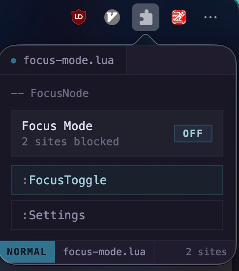
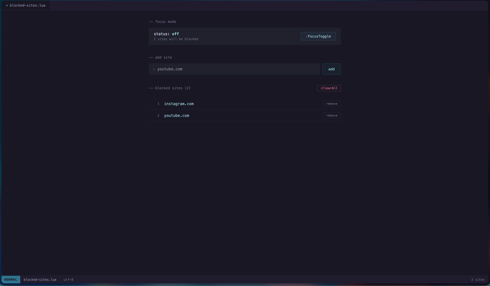

# FocusNode

A browser extension that helps you stay focused by blocking distracting websites. Built with React and Vite. Works in Chrome, Firefox, and Zen.

**FocusNode** is a pun on Node.js and "focus mode" - because staying focused should be as essential as Node.js is to modern development!

**Chrome**: [Available on the Chrome Web Store](https://chromewebstore.google.com/detail/focus-mode-blocker/bhkiedimpjpeoggbodjedjcopedhdaoo) · **Firefox**: [Available on Firefox Add-ons](https://addons.mozilla.org/en-US/firefox/addon/focusnode-website-blocker/)

## Screenshots

   

## Features

- **Toggle Focus Mode** - Quick on/off switch from the extension popup
- **Block Distracting Sites** - Add websites to your block list in the settings
- **Smart Redirects** - When you turn off focus mode on a blocked page, you're automatically redirected back to the original site
- **Subdomain blocking** - Blocking `youtube.com` also blocks `m.youtube.com`, etc.
- **Pomodoro sessions** - Choose focus/rest minutes and a cycle count; sites automatically unlock for rest and re-block afterward
- **Timer controls & alerts** - Pause/play, skip a phase, a soft ping at phase changes, and a “Rest time over” screen
- **Floating flip clock** - Theme-matched countdown, mode, cycle, and elapsed-progress bar; always-on-top picture-in-picture in supported Chromium browsers, compact window fallback elsewhere
- **Beautiful UI** - Modern, dark-themed interface built with React
- **Fast & Lightweight** - Built with Vite for optimal performance

## Installation

### Prerequisites

- Node.js (v16 or higher)
- npm or yarn

### Step 1: Clone and build

```bash
git clone <repository-url>
cd FocusNode/focus-react
npm install
npm run build
```

This compiles the React UI and places the output in `../FocusModeWebsiteBlocker/dist/`.

---

### Chrome / Edge / Brave

Install from the [Chrome Web Store](https://chromewebstore.google.com/detail/focus-mode-blocker/bhkiedimpjpeoggbodjedjcopedhdaoo) — the easiest way, and also works for Edge/Brave via the Chrome store.

**For a development build instead:**

1. Go to `chrome://extensions/` (or `edge://extensions/`, `brave://extensions/`)
2. Enable **Developer mode** (top-right toggle)
3. Click **"Load unpacked"**
4. Select the `FocusModeWebsiteBlocker` folder

---

### Firefox

Install from [Firefox Add-ons](https://addons.mozilla.org/en-US/firefox/addon/focusnode-website-blocker/) — the easiest way. For a development build instead, Firefox requires extensions to be signed; the easiest path for personal use is to install on Firefox Nightly or Developer Edition, which allow unsigned extensions.

**Firefox Nightly / Developer Edition:**

1. Go to `about:config`, accept the warning
2. Search `xpinstall.signatures.required` and set it to **false**
3. Package the extension:
   ```bash
   cd FocusModeWebsiteBlocker && zip -r ../focusnode.xpi . -x "*.DS_Store"
   ```
4. Go to `about:addons` → gear icon → **"Install Add-on From File…"** → select `focusnode.xpi`

**Temporary install (any Firefox, removed on quit):**

1. Go to `about:debugging#/runtime/this-firefox`
2. Click **"Load Temporary Add-on…"**
3. Select `FocusModeWebsiteBlocker/manifest.json`

---

### Zen

1. Go to `about:config`, accept the warning
2. Search `xpinstall.signatures.required` and set it to **false**
3. Package the extension:
   ```bash
   cd FocusModeWebsiteBlocker && zip -r ../focusnode.xpi . -x "*.DS_Store"
   ```
4. Go to `about:addons` → gear icon → **"Install Add-on From File…"** → select `focusnode.xpi`

**Temporary install (removed on quit):**

1. Go to `about:debugging#/runtime/this-firefox`
2. Click **"Load Temporary Add-on…"**
3. Select `FocusModeWebsiteBlocker/manifest.json`

---

## Usage

### Turning Focus Mode On/Off

1. Click the extension icon in your toolbar
2. Click the toggle button to turn Focus Mode ON or OFF
3. When ON, all open tabs matching your block list are blocked immediately

### Adding Sites to Block

1. Click the extension icon and select **"Open settings"**
2. Enter a website domain (e.g., `youtube.com` or `reddit.com`)
3. Click **"Add"**

### On a Blocked Page

- **"Turn off Focus Mode"** — disables focus mode and returns you to the original site
- **"Go back"** — returns to the previous page
- **"Open Focus Settings"** — opens the settings page

### Pomodoro Timer

1. Open the popup or settings and set **Focus / min**, **Rest / min** (1–180), and **Cycles** (1–99).
2. Click **Start pomodoro**. Each cycle is a focus period followed by a rest period, including the last cycle.
3. Focus blocks your listed websites; rest automatically restores blocked tabs. At rest's end, sites re-block, a ping plays, and the timer screen opens with **Rest time over**.
4. **Pause / Play** freezes/resumes the countdown without changing website access. **Skip** advances the current phase (and stays paused if already paused).
5. After the last rest, sites stay blocked until **Finish & unblock sites** or the manual Focus Mode toggle. **End session** stops early and unblocks sites. Using the manual toggle ends any timer session.

The timer continues with its popup closed and recovers its schedule after a browser restart or computer sleep. Browser alarms may be delayed while the computer is asleep; FocusNode catches up when it wakes.

**Floating timer:** from the popup, click **Floating timer**, then **Picture-in-picture** in the timer window for an always-on-top clock. Settings also offers PiP directly. Keep the originating page/window open while using PiP. Firefox/Zen and browsers without Document Picture-in-Picture use a regular compact window instead (not always on top).

FocusNode controls websites, not native desktop applications. Timer settings/session state are local to each browser, not synced between devices.

## Development

### Project Structure

```
FocusNode/
├── focus-react/                  # React source
│   ├── src/
│   │   ├── PopupApp.jsx
│   │   ├── OptionsApp.jsx
│   │   └── storage.js
│   └── vite.config.js
└── FocusModeWebsiteBlocker/      # Extension root
    ├── manifest.json
    ├── sw.js                     # Background service worker
    ├── blocked.html / blocked.js # Blocked-site page
    └── dist/                     # Built React UI (generated)
```

### Rebuilding after changes

```bash
cd focus-react
npm run build
npm test
npm run lint
```

Then reload the extension in your browser.

## Permissions

- **storage** — saves your settings and block list
- **tabs** — reads and updates tabs to enforce blocking
- **alarms** — advances pomodoro phases even when the extension popup is closed
- **offscreen** — plays the timer ping from a hidden audio document in Chrome (Firefox uses background-page audio)

## Troubleshooting

**Sites not being blocked** — make sure Focus Mode is ON, the domain is in your list, and you've rebuilt after any source changes.

**Extension not loading** — run `npm run build` in `focus-react/` first, and make sure you're pointing at the `FocusModeWebsiteBlocker` folder, not `focus-react`.

**Firefox/Zen install rejected** — `xpinstall.signatures.required` must be set to `false` in `about:config` before installing the `.xpi`.
